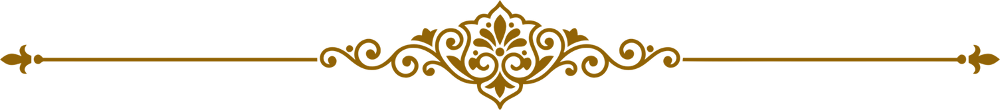
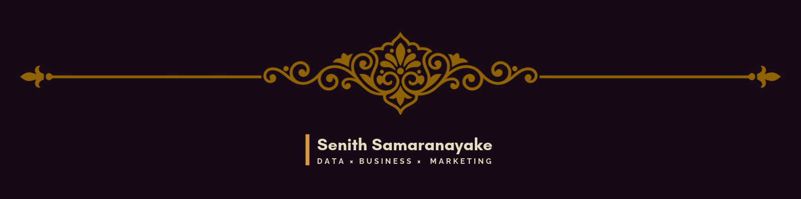

 

<h2>Data, business and marketing</h2>

  
  

## Hello, I am Senith

I am a Computer Science and Technology undergraduate focused on **data analysis, business analysis and marketing strategy**. I enjoy turning practical questions into clear analysis, useful visuals and better decisions.

## Featured work

### [Sri Lanka Tourism Analytics](https://github.com/SenLODiGi/Sri_Lanka_Tourism_Analytics)

An end-to-end analysis of tourist arrivals to Sri Lanka, covering data cleaning, exploratory analysis, SQL, visualisation and a written report.

- Analyses recovery, seasonality and source-market performance.
- Uses Python, pandas, NumPy, Matplotlib, Seaborn, Plotly and SQL.
- Includes a clear like-for-like comparison for partial-year 2026 data.

  <a href="https://github.com/SenLODiGi/Sri_Lanka_Tourism_Analytics/blob/main/reports/ANALYSIS_REPORT.md">Read the report</a>
  &nbsp; | &nbsp;
  <a href="https://github.com/SenLODiGi/Sri_Lanka_Tourism_Analytics">View repository</a>

  
  

## Selected projects

| Project | Summary | Focus |
| --- | --- | --- |
| [AI Sentiment Analyzer](https://github.com/SenLODiGi/AI-Sentiment-Analyzer) | Web app for polarity, subjectivity and text sentiment analysis. | Python, NiceGUI, NLP |
| [SmartSplit](https://github.com/SenLODiGi/smartsplit) | Receipt-based group expense splitting with line-item assignment. | OCR, algorithms, product thinking |
| [CostMap](https://github.com/SenLODiGi/CostMap) | Travel budgeting and expense tracking for Sri Lankan travellers. | Travel, cost tracking, UX |
| [BeakerBoss](https://github.com/SenLODiGi/BeakerBoss) | Laboratory inventory and safety management system. | C, data structures, systems |

## Tools

  

## Current direction

I am building stronger skills in customer and market segmentation, marketing performance analysis, business intelligence and tourism demand analysis.

**Question -> Data -> Insight -> Decision**

  <a href="https://www.linkedin.com/in/senith-samaranayake/">Connect on LinkedIn</a>
  &nbsp; | &nbsp;
  <a href="https://github.com/SenLODiGi?tab=repositories">Explore my repositories</a>

Curious by nature. Analytical by practice. Strategic by perspective.

