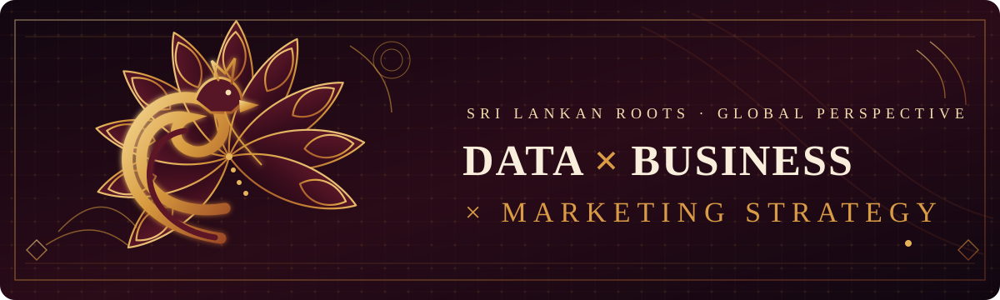

<!--
  Senith Samaranayake | GitHub Profile README
  Theme: Sri Lankan heritage · Data · Business · Strategy
-->

 

  
  

<b>SRI LANKAN ROOTS · GLOBAL PERSPECTIVE</b>

## 01 — The perspective

I’m a Computer Science and Technology undergraduate building my capabilities across **data analysis, business analysis, and marketing strategy**.

My professional background began in marketing and growth. That experience led me to look deeper at the evidence behind decisions: customer behaviour, market patterns, performance, and the systems that help organisations work better.

My current priority is **Data Analysis**, supported by business understanding and strategic marketing experience.

| Focus | What I explore |
|:--|:--|
| **01 · Data Analysis** | Data cleaning, exploratory analysis, statistics, SQL, visualisation and communicating findings |
| **02 · Business Analysis** | Business questions, requirements, process thinking and practical problem-solving |
| **03 · Marketing Strategy** | Market research, customer insights, campaign performance and data-informed growth |

## 02 — Featured analysis

### 🇱🇰 Sri Lanka Tourism Analytics

An end-to-end analysis of tourist arrivals to Sri Lanka, exploring recovery, monthly seasonality, source-market patterns and year-on-year performance.

**Project scope**
- **Coverage:** January 2022 – October 2026
- **Workflow:** inspection → cleaning → exploratory analysis → statistical analysis → SQL → visualisation
- **Tools:** Python, pandas, NumPy, Jupyter, Matplotlib, Seaborn, Plotly and SQL

**Selected findings from the project**
- Annual arrivals increased from **719,978 in 2022** to **2,362,521 in 2025**.
- January–October 2026 recorded **1,862,304 arrivals**, compared with **1,890,687** for January–October 2025.
- India contributed **1,873,958 arrivals** across the combined period, representing **22.08%** of arrivals.

Note: 2026 is partial-year data through October. The project uses January–October comparisons for like-for-like year comparisons.

  <a href="https://github.com/SenLODiGi/Sri_Lanka_Tourism_Analytics/blob/main/reports/ANALYSIS_REPORT.md">READ THE ANALYSIS REPORT</a>
  &nbsp;·&nbsp;
  <a href="https://github.com/SenLODiGi/Sri_Lanka_Tourism_Analytics">EXPLORE THE REPOSITORY</a>

  
  

  

## 03 — Selected work

A few other projects across analysis, software and practical problem-solving.

<table>
<tr>
<td width="50%" valign="top">

### [AI Sentiment Analyzer](https://github.com/SenLODiGi/AI-Sentiment-Analyzer)

A Python web application for quick and detailed text sentiment analysis, including polarity, subjectivity and phrase-level exploration.

Python · NiceGUI · TextBlob · NLTK

</td>
<td width="50%" valign="top">

### [SmartSplit](https://github.com/SenLODiGi/smartsplit)

A group expense-splitting application with receipt OCR, line-item assignment and an algorithm for simplifying shared debts.

Full-stack development · OCR · Algorithms

</td>
</tr>
<tr>
<td width="50%" valign="top">

### [CostMap](https://github.com/SenLODiGi/CostMap)

A travel budgeting and expense-tracking concept tailored to local and international travellers in Sri Lanka.

Travel · Cost tracking · Product thinking

</td>
<td width="50%" valign="top">

### [BeakerBoss](https://github.com/SenLODiGi/BeakerBoss)

A chemistry laboratory inventory and safety management system developed as a data structures and algorithms project.

C · Data structures · Inventory management

</td>
</tr>
</table>

## 04 — The analytical toolkit

  

## 05 — What I plan to explore next

The tourism project is the starting point of a growing analytical portfolio. These are future project directions, not completed projects:

- **Customer & market segmentation** — identifying meaningful groups from customer or market data.
- **Marketing performance analytics** — connecting campaign activity, channel performance and outcomes.
- **Business intelligence dashboards** — turning operational datasets into clear decision-support views.
- **Tourism demand exploration** — extending Sri Lankan tourism analysis with forecasting and additional indicators where reliable data is available.
- **Sales & revenue analysis** — exploring trends, seasonality, product performance and customer behaviour.

My approach:

**Question → Data → Analysis → Insight → Decision**

## 06 — Activity & collaboration

I’m interested in thoughtful collaborations involving data, business problems, technology and meaningful projects.

  <a href="https://www.linkedin.com/in/senith-samaranayake/">CONNECT ON LINKEDIN</a>
  &nbsp;·&nbsp;
  <a href="https://github.com/SenLODiGi?tab=repositories">EXPLORE MY REPOSITORIES</a>

### DATA × BUSINESS × MARKETING

Curious by nature · Analytical by practice · Strategic by perspective

